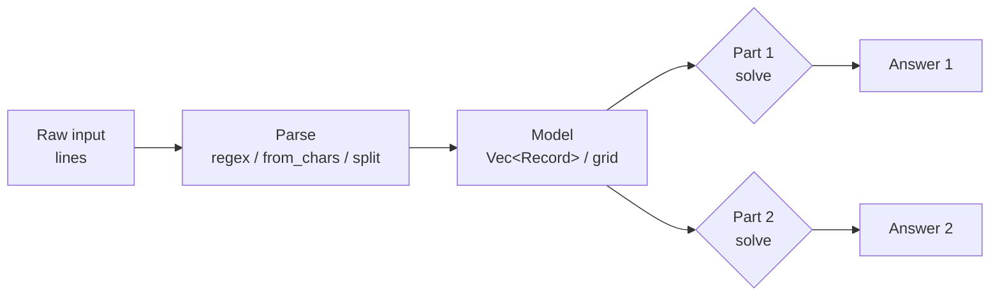
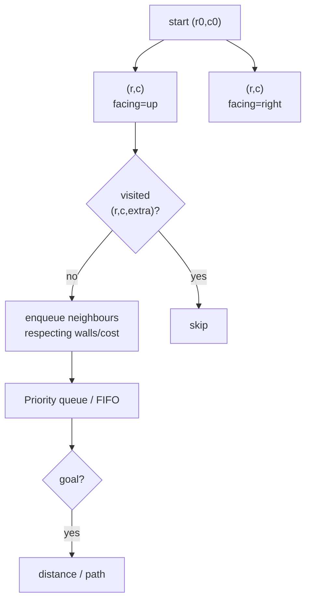
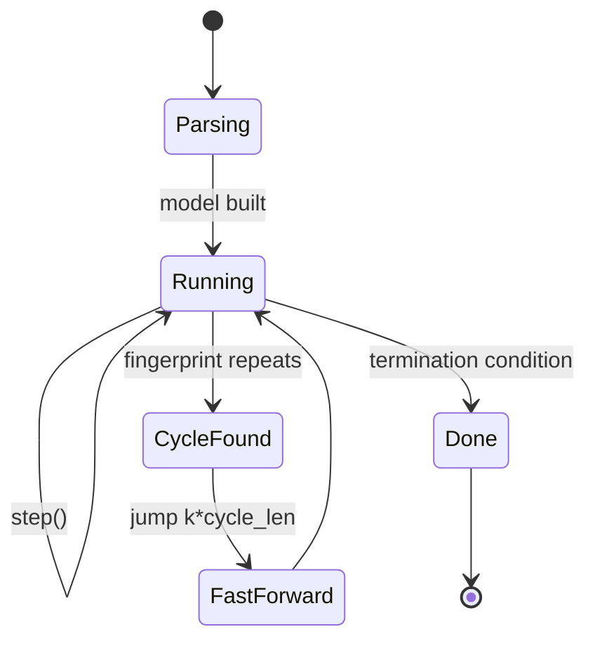
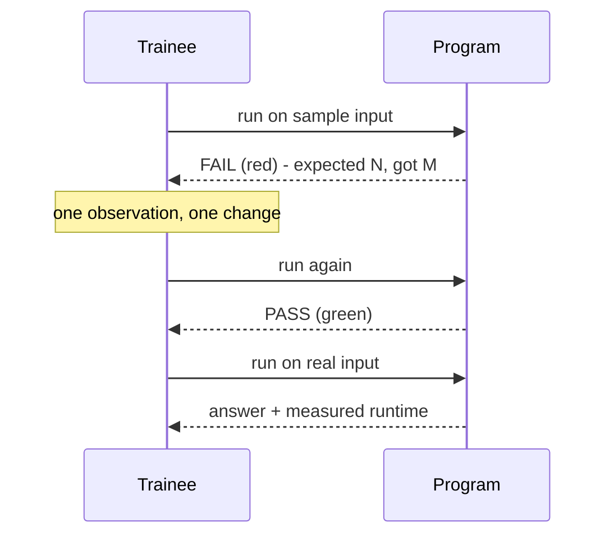

# Mermaid templates for puzzle decomposition

Ready-made shapes for the coaches. Rendering: VS Code Copilot Chat renders mermaid blocks; if not, paste into mermaid.live.

## 1. Data-flow decomposition (default shape)

Use for almost every puzzle: parse → model → solve → report. Part 2 usually branches at "model".



## 2. Grid as graph (BFS/DFS/Dijkstra)

Use for maze/path puzzles; make the state tuple explicit — the part-2 twist usually lives in `extra`.



## 3. State machine (simulation puzzles)

Use when the puzzle describes a machine, crabs, lanternfish, intcode… Enum states make illegal states unrepresentable.



## 4. Algorithm decision flow

Use when comparing approaches with the trainee (pairs with aoc-algorithms output).

```mermaid
flowchart TD
    Q{Input size?} -- "&le;10^4" --> BRUTE[Brute force\nkeep it simple]
    Q -- "&le;10^6" --> SORTED[Sort / heap / sweep\nO(n log n)]
    Q -- "&ge;10^9" --> MATH{Structure?}
    MATH -- "repeats" --> CYCLE[Cycle detection]
    MATH -- "counting" --> DP[DP / digit DP / CRT]
    MATH -- "closed form" --> FORM[Arithmetic series]
```

## 5. Sequence view of the red-green loop

Use when the trainee keeps skipping the sample test.


