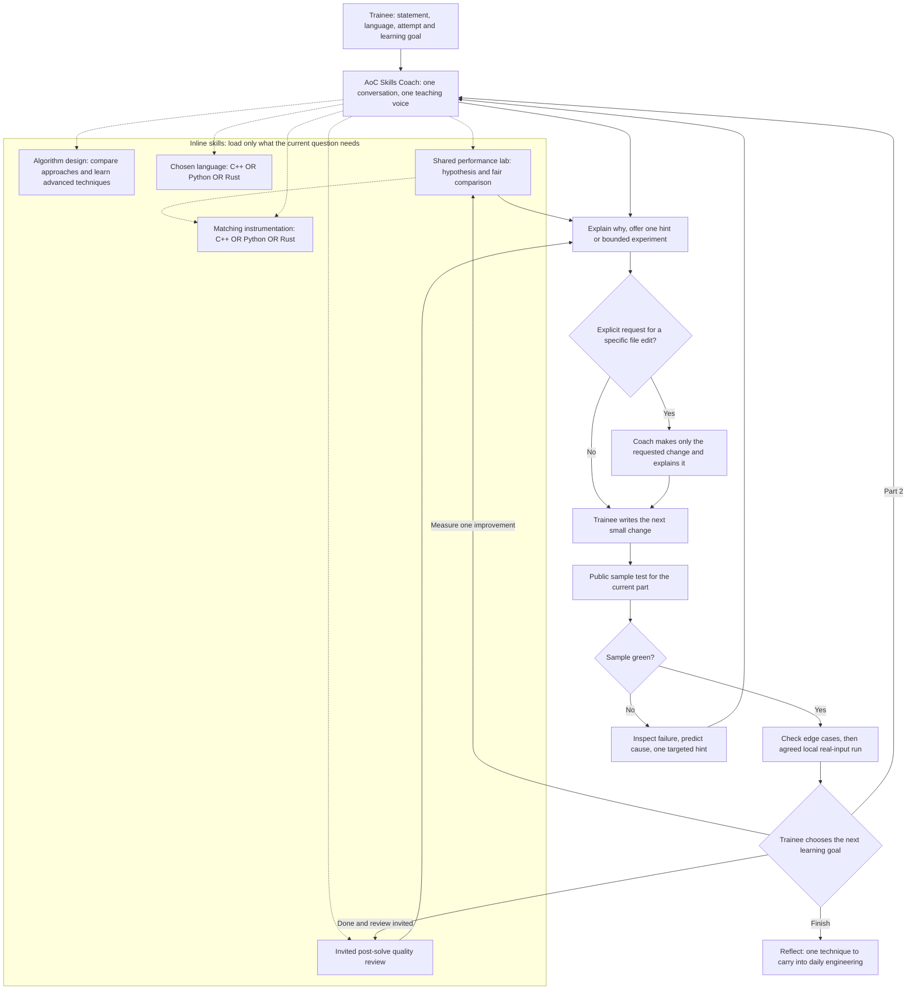

# AoC Skills Coach: one coach, inline skills

Select **AoC Skills Coach** and stay in that conversation from understanding the puzzle to reviewing your implementation. The coach loads relevant knowledge inline. The complete runtime package is one agent file plus the skills directory.

The workflow optimizes for learning and a smoother conversation, not for fewer words at all costs. Expect explanations of causes, trade-offs and applications outside AoC, with one manageable next decision. More detail does not mean more solution code.

## Get started

Start a fresh Copilot chat in this workspace and select **AoC Skills Coach**. To use it in another puzzle workspace, copy:

- [The coach agent](../.github/agents/aoc-skills-coach.agent.md) into `.github/agents/`.
- The complete [skills directory](../.github/skills/) into `.github/skills/` (each skill folder carries its own bundled references).
- Optionally, [templates](../templates/) and [the scaffold script](../scripts/new_day.sh). Skills reuse a day scaffold when one exists and otherwise adapt to the workspace's build files.

That agent file plus the skills directory is the complete runtime package. The other files in this repository are documentation or optional scaffolding. If the target workspace has its own Copilot instructions, the coach follows whichever rule is stricter.

Use **Chat: Open Customizations** to check that the agent and nine skills are discovered. Start a new session after installing if the current session does not see them. Skill names should also appear when typing `/`; discovery alone does not prove automatic selection.

Project skills are discoverable workspace-wide, not private to a particular agent. Use **AoC Skills Coach** as the entry point for the intended learning flow. User-level or other workspace skills may also be discovered.

No model is pinned in the agent: use your selected model. Keep approval controls enabled. Editing and execution tools are available for explicit requests, so the teaching rules are behavioral constraints, not a technical read-only boundary.

Example opening:

> Day 5 part 1, Rust. Here is the statement and my parser. I'd like detailed explanations, but one step at a time. Please coach me; don't edit my files.

The coach reads existing context, establishes your current understanding and loads only the Rust lane. It adds algorithm, diagnostic, performance or review skills when the discussion needs them.

## Architecture and usage

Solid arrows show the trainee's learning loop. Dotted arrows show skills loaded into the same coach context. Reusable puzzle diagrams are in the [Mermaid templates](./mermaid-templates.md).

### Coaching contract

The coach carries the no-spoiler ladder itself: understand -> model -> compare -> represent -> test -> hint -> tiny toy example -> outline; full solution only on explicit request. Stop at the rung that lets the trainee continue. Do not accumulate snippets into an unsolicited complete solution.

The workflow also requires:

- **No automatic edits:** code, tests, scaffolds, configuration and scratch files are trainee-owned. "Help me optimize" or "review this" does not authorize edits. A formatter, generator, dependency install or shell redirection is not a loophole.
- **Scoped consent:** "Add this sample assertion" permits that assertion, not a solver. "Show the full solution" permits displaying it with a walkthrough, not writing files. Permission is bounded to the requested change.
- **Sample first:** each part needs its own red-green evidence. A sentinel failure is setup guidance; after filling the statement's expected answer, observe red for the missing behavior. Only after green and edge checks should real input be used.
- **Evidence, not theater:** ask what the trainee predicts; distinguish an observation from a hypothesis. Cite relevant authoritative docs, verify version-sensitive claims, and report checks not run. Never invent benchmark results.
- **One conversation:** keep the trainee's reasoning, decisions, test evidence and skill guidance in this coach conversation. If skill loading is unavailable, the coach can read the relevant skill file and disclose that fallback.
- **Private input stays local:** do not upload, publish or commit personalized inputs or reports containing them.

### Skill map

| Skill | Loaded for |
|---|---|
| [aoc-algorithm-design](../.github/skills/aoc-algorithm-design/SKILL.md) | State design, two approaches, DP, graph search, cycles, intervals, arithmetic (bundles its own algorithm playbook) |
| [aoc-cpp-coaching](../.github/skills/aoc-cpp-coaching/SKILL.md) | C++23/26 parsing, ownership, ranges, containers and idioms |
| [aoc-python-coaching](../.github/skills/aoc-python-coaching/SKILL.md) | Python stdlib, types, modeling, iteration and caching |
| [aoc-rust-coaching](../.github/skills/aoc-rust-coaching/SKILL.md) | Rust 2024 borrowing, enums, iterators and errors |
| [aoc-performance-lab](../.github/skills/aoc-performance-lab/SKILL.md) | Shared benchmark method and one optimization experiment |
| [aoc-cpp-instrumentation](../.github/skills/aoc-cpp-instrumentation/SKILL.md) | CMake, sanitizers, clang-tidy, timing/profiling |
| [aoc-python-instrumentation](../.github/skills/aoc-python-instrumentation/SKILL.md) | Test runner, cProfile, timeit, allocation tracing |
| [aoc-rust-instrumentation](../.github/skills/aoc-rust-instrumentation/SKILL.md) | Cargo, clippy, profiles, release timing |
| [aoc-quality-review](../.github/skills/aoc-quality-review/SKILL.md) | Invited post-solve review and learning retrospective |

## What a session feels like

| Trainee says | Coach does | Trainee keeps ownership of |
|---|---|---|
| "I don't understand the puzzle." | Restates the transformation, asks for a prediction, sketches a small model when useful | Choosing/confirming the model |
| "Would DP help here?" | Explains repeated subproblems and compares two approaches at the appropriate rung | Defining the state and choosing the approach |
| "The borrow checker is fighting me." | Loads Rust knowledge, traces ownership and offers one hint | Making the next implementation change |
| "My sample passes; this seems slow." | Loads the performance lab plus matching instrumentation, agrees on a baseline | Predicting the bottleneck and implementing one experiment |
| "Optimize this." | Clarifies the objective and measurement plan; does not rewrite files | Choosing and applying the change |
| "Please add just this sample test." | Makes only that requested edit and explains it | Implementing the solver |
| "Done; review my design." | Asks about complexity, a defended choice and a concern before findings | Explaining the design and deciding whether to refactor |

For manual skill selection, stay on **AoC Skills Coach** and use, for example, `/aoc-performance-lab` or `/aoc-cpp-instrumentation`. Invoking a skill does not itself authorize commands or edits; use the coach to preserve the intended teaching flow.

## Validate the workflow

Use the reusable [coaching scenarios](./skill-workflow-evals.json). They cover C++ lifetime diagnostics and no-edit consent, Python measurement honesty, and Rust review/scoped-edit boundaries.

For each scenario, use a fresh chat with the same model, tools and repository state:

1. Select **AoC Skills Coach** and send each scenario turn separately.
2. Inspect tool activity, skill selection, unexpected edits, spoiler level and whether the coach waits at decision points.
3. Check language routing separately from explicit `/skill-name` invocation. Only the matching language should load; performance should compose with its instrumentation.
4. Score the scenario expectations and ask an engineer whether the explanation was useful, coherent and appropriately detailed. Fewer tokens is not the objective.
5. Also try an unknown language, a language switch, an unfinished part 2, unavailable tooling, and "show the full solution" without file-write permission.

Instruction-level scenario simulations and metadata/link/Mermaid checks are useful smoke tests, not proof of actual VS Code discovery, automatic skill invocation, permission enforcement or improved learning outcomes. Verify those in the intended Copilot harness before rolling the workflow out to a team. These smoke tests alone do not establish improved performance, learning outcomes or UX.

## Platform references

Configuration checked against the public docs on 2026-11-13:

- [VS Code Agent Skills](https://code.visualstudio.com/docs/agent-customization/agent-skills): `.github/skills/<name>/SKILL.md`, progressive loading, slash invocation and default inline context.
- [VS Code custom agents](https://code.visualstudio.com/docs/agent-customization/custom-agents): agent selection, tool scope and verification.
- [Agent Skills specification](https://agentskills.io/specification): portable skill metadata.

Skill loading availability depends on the client/harness. This workflow uses inline skills and does not install plugins, change global settings or add background services.
